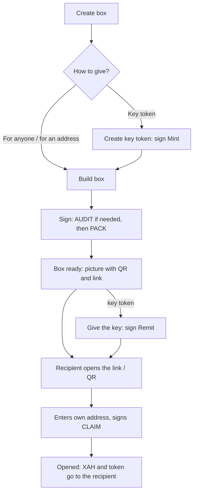

# Xahau Gift Box — guide (in plain words)

## What this is
A single web page for gift boxes on Xahau. You put XAH and/or one URIToken into a box, give the recipient a link, a QR code or a key token, and they collect the gift themselves.
- No server: the page only reads the public ledger and builds transactions.
- You sign every step yourself in Xaman (or copy the JSON and sign it in another tool).
- Networks: Testnet (NetworkID 21338) and Mainnet (21337), switched with the button at the top.
- Languages: EN / ES / FR / RU (menu at the top, defaults to the phone's language).

## What is in the repository
- `index.html` — the page itself and all its screens.
- `css/app.css` — the look (colors, buttons, cards).
- `js/app.js` — all the logic: reading the ledger, building transactions, QR, ledger counter.
- `js/config.js` — settings (Xaman key, page address, Evergram link, networks). Public values only.
- `js/i18n.js` — texts in 4 languages.
- `vendor/boxlib.js` — ready-made libraries (signatures, hashes, QR) bundled into one file.
- `vendor/xumm-oauth2-pkce-2.8.7.min.js` — the official Xaman sign-in library.
- `vendor/LICENSES.md` — licenses of these libraries.
- `img/` — box pictures, key picture, small icons and the interface background.
- `README.md` — a short description.
- `GUIDE.md` — this guide.
- `.nojekyll`, `.gitignore` — service files for GitHub Pages and git.

## Screens
- **Home** — "Create box", "Open box", "My boxes".
- **Account** — sign in with Xaman or just enter an address (then the page shows JSON to sign).
- **Create box** — what to put in, how to give it, time limit.
- **Sign** — a "Sign in Xaman" button or JSON to copy, plus "Signed — check the ledger".
- **Box ready** — box picture with QR, download / share, link.
- **Box for you** — the recipient sees what is inside and opens it.
- **Opened** — what was received.
- **My boxes** — all locked boxes on the account (from the ledger) and "Take back".

## Box modes
| Mode | Who can open | What is in the QR / link |
|---|---|---|
| **Link / QR → For anyone** | Whoever opens the link first | The box key. The link = money, do not show it publicly. |
| **Link / QR → For one address** | Only the given address | A signature for that address. The link can be shown publicly. |
| **Key token** | Whoever currently holds this URIToken | Only the box number. The key holder opens it. |

## How to create a box
1. "Create box" → sign in (Xaman or address). The account must have the hook installed; otherwise the page says there is no hook and the button is disabled.
2. Enter an XAH amount (the page shows how much is available) and/or pick one URIToken.
3. Choose how to give it: "For anyone", "For one address" (enter the address) or "Key token".
4. For a key token:
   - "Create key token" → the page builds a `URITokenMint` → you sign → "Signed — check the ledger". The new key is selected automatically (tagged "new").
   - Or pick an existing token of yours (a token inside a box, a burnable token or a token for sale cannot be picked).
5. Choose a time limit: none, 1, 7, 30 or 90 days.
6. "Build box" → sign. Sometimes the hook first asks for step 1 AUDIT; then sign that first, then PACK.
7. "Signed — check the ledger" → "Box ready" screen: picture with an "OPEN BOX" QR, and the link.
8. For a key token: "Give the key token to an address" → enter the address → sign the `Remit`. Now that address can open it.

## How to open a box (recipient)
1. Open the link, or "Open box" → paste the text, scan with the camera or pick a photo of the QR.
2. The page switches network by itself if the QR is from another network, and shows: what is inside, mode, time limit, status.
3. Enter your address → "Open box" → sign.
4. The page checks: the time limit has not passed; for "one address" it is the right address; for a key token you are the current holder.
5. "Signed — check the ledger" → "Opened" screen with what you received.

## Ledger counter and time limit
- At the bottom of the page there is a live counter: the current ledger number, updated about every 4 seconds (paused on a hidden tab). Next to it is the average speed, ≈ seconds per ledger (measured over the last 100 ledgers).
- The box time limit is stored in the hook as a **ledger number**, not a date. The page computes the number from the average speed (3.5 s until measured), and the date shown is approximate.
- Screens show "≈ … left · N ledgers". After the limit the box is marked "Expired" and cannot be opened.
- "My boxes" → "Take back" (or "Take the box back" by VC number) builds an `OPEN` from the owner to return the contents. Whether this is allowed at that moment is decided by the hook; on the page the VC button is labeled "after the time limit".

## What is fixed in the key token (what the page does today)
- **Issuer** — the address that signed the mint. This is the box account (the page mints on the connected account that has the hook).
- **URI** — a link to the key picture on the page itself: `<page address>/img/key.jpg?k=<16 random characters>`. The random part makes every key unique. **The box contents are not written into the URI yet.**
- **Flags 0** — not burnable by the issuer: the box account cannot burn or take the key away from a person. The holder can burn it themselves in their own wallet (`URITokenBurn`) whenever they want; the page has no button for this.
- Nobody can change the URI or the Issuer after minting.
- Which exact token is the key is recorded in the hook state at PACK. Only that token opens the box; another token with the same picture will not work.

## What to set up before publishing (`js/config.js`)
- `APP_URL` — the exact page address (`https://khorhito11111000.github.io/Xahau-Box-App/`, later your own domain). It goes into QR codes, links and the key token URI. Empty = the address the page is opened from. **Set it before the first mainnet mint**, otherwise old keys will point to the old address.
- `XAMAN_API_KEY` — the public API Key from apps.xaman.dev (not a secret!). Passed through a form, not in chat. In the Xaman app settings, set the page address as the redirect. Empty = Xaman sign-in is off and the JSON option works.
- `EVERGRAM_URL` — currently `https://evergram.app`. Change it if there is a link to the xApp inside Xaman.

## Honest limitations
- **Sibling hooks.** All hooks on one account are equal. Hooks that send payments on their own can spend the box's XAH (the payout then fails and the box stays closed until the balance is topped up). A buggy or unknown hook can change or delete box data. The box hook does not forbid them: install only hooks you trust and understand. In v15 (in progress) the box's XAH will be reserved.
- **Trust in the owner.** The box lives on the owner's account. The owner can take a box back ("Take back") and controls the account and its hooks.
- **Everything is public.** Amounts, tokens, time limits, addresses and hook state are visible to everyone on the ledger. The page code is also open to anyone who opens it.
- **"For anyone" = cash.** Whoever uses the link first takes it.
- **Fake keys.** Anyone can mint their own token with a similar picture. They cannot open the box with it, but they can pass the token off as "a box". The page does not check this separately yet (see below).
- The page keeps its box history only in the phone's browser (localStorage). Clear the browser and the VC numbers are gone; without the VC you cannot take a box back through the page.

## Planned (not in the code yet)
- **Three box pictures by contents:** "XAH + token", "XAH only", "token only". Closed box only. Same scale and same color. Today the page draws the QR on a single picture, `img/box.jpg`.
- The same pictures for the key token (today a single `img/key.jpg`).
- Write the box contents into the key URI (e.g. `xah=…`, `t=<token ID>`) and a **Digest** (hash of the description).
- **Check on the page:** key Issuer = box address, URI/Digest match what actually sits in the hook. Otherwise — "Fake / does not match".
- After opening — a note "you can keep the key as a souvenir or burn it in your own wallet".
- **"Support the project" block** with an address and a "Copy" button, voluntary (waiting for the address).
- Paid designs from postcard artists — later.
